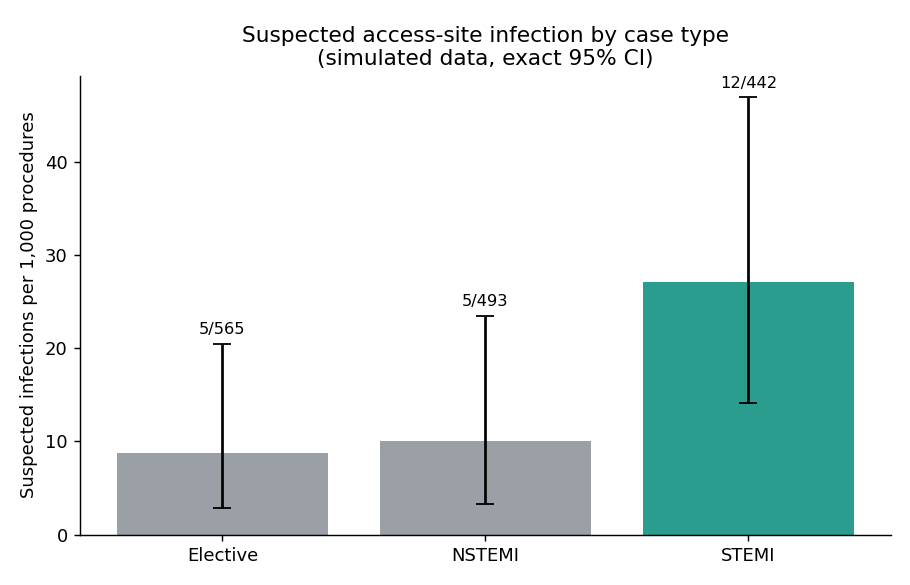
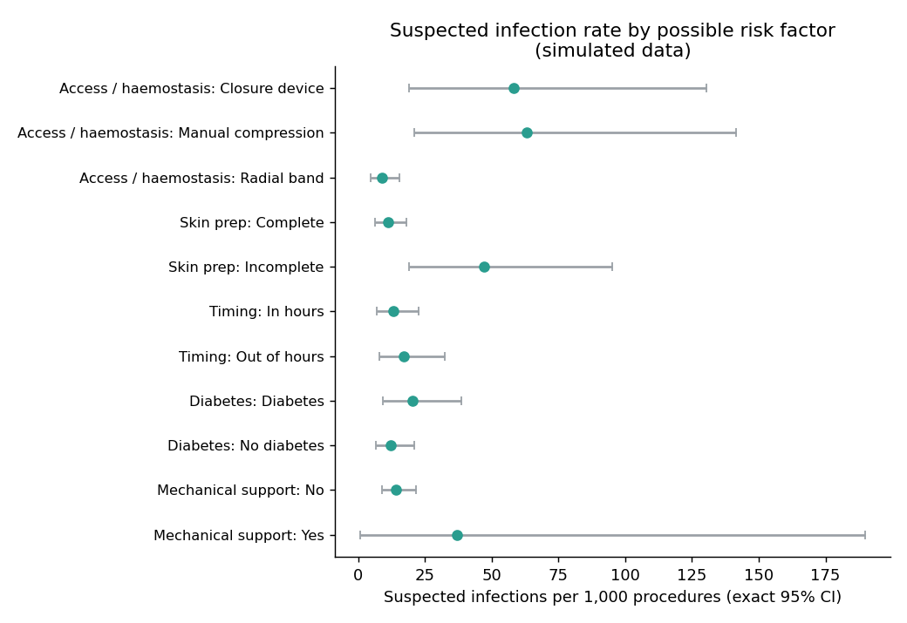
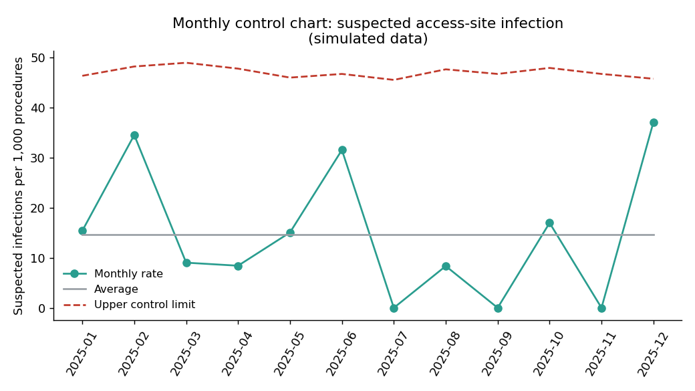

# Access-Site Infection After Cardiac Catheterisation: STEMI vs Elective PCI

> **Important note on data:** This project uses **simulated data**. It contains no patient or hospital data. The dataset was built to resemble the scale and structure of UK cardiac audit data (NICOR/BCIS), so the analysis workflow looks like a real surveillance project. The infection risks are set within ranges published in the medical literature, but the extra risk for urgent STEMI cases is an **assumption**, not a published finding. Results show how the analysis works, not what any real cath lab achieves.

## Question
Do patients treated with primary PCI for STEMI have a higher rate of access-site infection within 30 days than patients treated electively, and which factors (access route, haemostasis method, skin preparation, mechanical support) are linked to infection?

## Why this project
I am a cath lab head nurse. Access-site infection is rare after cardiac catheterisation but serious when it happens, and infection-control teams track it as a rate per 1,000 procedures. Because events are rare, this project reports **exact confidence intervals** and is careful not to claim differences the data cannot support.

## Dataset (simulated)
| | |
|---|---|
| Procedures | 1,500 PCI procedures in one year (2025): 565 elective, 493 NSTEMI, 442 STEMI |
| Follow-up | 30 days for access-site infection |
| Access route | Radial 89%, femoral 11% |
| Tables | `procedures.csv`, `operators.csv`, `infection_events.csv` |

**Outcome levels** (as in routine surveillance):
- **Suspected infection:** clinical signs at the access site that prompt review (22 cases).
- **Confirmed infection:** a deep or bloodstream infection, or a culture-positive infection (10 cases).

## Key results
Rates are per 1,000 procedures with exact 95% confidence intervals.

| Group | Procedures | Suspected infection | Confirmed infection |
|---|---|---|---|
| All procedures | 1,500 | 14.7 (9.2 to 22.1) | 6.7 (3.2 to 12.2) |
| Elective | 565 | 8.8 (2.9 to 20.5) | 3.5 (0.4 to 12.7) |
| NSTEMI | 493 | 10.1 (3.3 to 23.5) | 4.1 (0.5 to 14.6) |
| STEMI | 442 | 27.1 (14.1 to 46.9) | 13.6 (5.0 to 29.3) |



**STEMI vs elective (Fisher's exact test):**
- Suspected infection: rate ratio 3.07 (95% CI 1.09 to 8.64), p = 0.028.
- Confirmed infection: rate ratio 3.83 (95% CI 0.78 to 18.91), p = 0.148. This is **not statistically significant**, because there were only 6 and 2 events.

**Other observations (suspected infection, wide confidence intervals):**
- Incomplete skin preparation: 47.3 vs 11.1 per 1,000 with complete preparation.
- Femoral access: about 58 to 63 per 1,000, against 9.0 per 1,000 for radial.
- Out-of-hours and diabetes show only small differences, with overlapping intervals.



**Monthly control chart:** no month crossed the upper control limit, so the monthly rate looks stable across the year.



## Conclusion and limitations
In this simulated dataset, STEMI cases had a higher rate of suspected access-site infection than elective cases, but the confirmed-infection difference could not be separated from chance. **This result is partly built into the simulation:** STEMI cases were given higher infection odds, more femoral access, and less complete skin preparation. The project therefore demonstrates the method (rates per 1,000, exact confidence intervals, Fisher's test, a control chart, and SQL) and not a real clinical finding.

Other limits: only 22 suspected and 10 confirmed events, so subgroup estimates are very imprecise; operator comparisons are not reliable at this event count; and a real evaluation would need approved hospital data, case definitions from national surveillance criteria, and adjustment for confounders.

## SQL
`sql/queries.sql` contains ten queries on the three tables: overall and grouped rates, a monthly 3-month moving average (window function), a JOIN with operator ranking, severity and organism breakdowns, time to onset (CASE), and a high-risk profile (CTE). Run them all with:
```bash
python sql/run_queries.py
```

## Data sources and how the simulated numbers were chosen
| Item | Value used | Source |
|---|---|---|
| Radial access share | About 89% (2019/20) | [NAPCI 2021 Summary Report (NICOR)](https://www.hqip.org.uk/wp-content/uploads/2026/03/NAPCI-Domain-Report_2021_FINAL.pdf) |
| Radial use and ACS share of PCI | About 94% radial and 70% ACS (2022/23) | [BCIS national audit presentation, reported by TCTMD](https://www.tctmd.com/news/uk-cardiac-audit-reveals-some-good-some-appalling-trends-pci) |
| Case mix (elective, NSTEMI, primary PCI) | Roughly 38%, 32%, 30% | [NICOR PCI Hospital Report, Norfolk and Norwich University Hospital, 2015 to 2018](https://www.nnuh.nhs.uk/wp-content/uploads/2022/07/NICOR-outcome-data.pdf) |
| Femoral groin infection | About 0.2% with manual compression and 0.6% with closure devices | [Meta-analysis (Am Heart J 2010;159:518-531), as reported by Cardiovascular Business](https://cardiovascularbusiness.com/node/1602) |
| Infection after closure devices | Reported range 0% to 5.1% | [Malekpour and Castillo, HMP Global Learning Network](https://www.hmpgloballearningnetwork.com/site/vdm/content/infection-perilous-complication-closure-device) |
| Infectious complications in a PCI cohort with closure devices | 1.6% | [J Invasive Cardiol, 2010](https://hmpgloballearningnetwork.com/site/jic/articles/increased-vascular-access-complications-patients-renal-dysfunction-full-title-below) |
| Femoral vs radial arterial catheter infection (ICU, per 1,000 catheter-days) | Femoral about 4 times radial | Lorente et al., Critical Care 2006 ([doi:10.1186/cc4930](https://link.springer.com/doi/10.1186/cc4930)) |

**Assumptions (not published effect sizes):** higher odds of infection for STEMI (1.5), NSTEMI (1.25), diabetes (1.6), BMI of 35 or more (1.5), mechanical support (2.0), incomplete skin preparation (1.8), and age 75 or more (1.2). Suspected infections are modelled as about 2.5 times more frequent than confirmed ones. All constants are at the top of `generate_data.py` and can be changed.

## How to reproduce
```bash
pip install pandas numpy scipy matplotlib
python generate_data.py      # creates the three CSV files in data/
python analysis.py           # rates, tests, charts (saved to results/ and images/)
python sql/run_queries.py    # runs the SQL queries
```

## Project status
- [x] Simulated data generator and dataset
- [x] Python analysis with exact confidence intervals and a control chart
- [x] SQL queries
- [ ] Power BI dashboard for infection-prevention reporting (in progress)

## Repository structure
```
cath-lab-access-site-infection/
├── generate_data.py
├── analysis.py
├── data/
│   ├── procedures.csv
│   ├── operators.csv
│   └── infection_events.csv
├── sql/
│   ├── queries.sql
│   └── run_queries.py
├── images/                  # charts used in this README
└── README.md
```
`analysis.py` also writes result tables to a `results/` folder when it runs.

## Author
**Yosra El Nagar**, Cath Lab Head Nurse moving into Healthcare Data Analytics
[LinkedIn](https://www.linkedin.com/in/yosra-nagar-9a6862118/) | [GitHub](https://github.com/yosras-dotcomAi)
